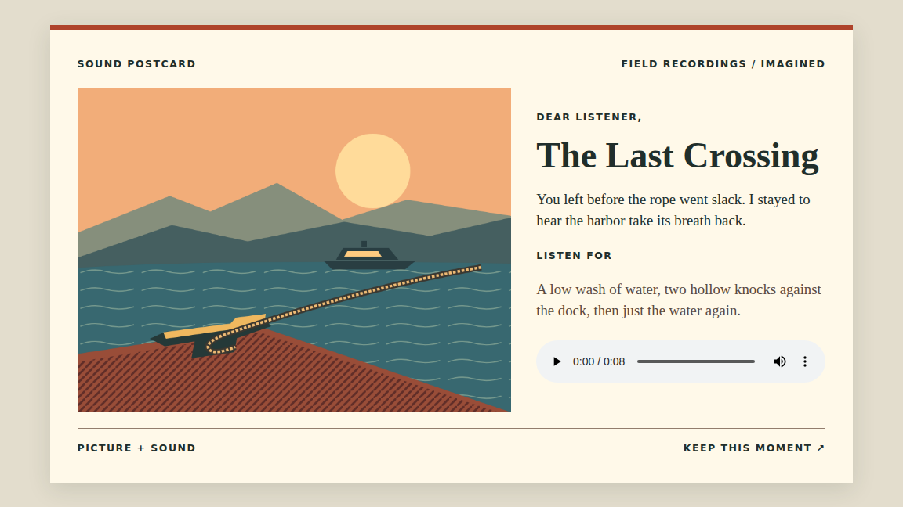

# Sound Postcard

A still image catches the instant **before** a sound. Press play to hear what happens next. This [Agent Skill](SKILL.md) directs a coding agent to make the image and an eight-second sound effect with Pollinations and bind them into one offline HTML postcard. No hosting, build step, or credentials in the card.

**Try it without spending:** [download The Last Crossing](https://raw.githubusercontent.com/Marcus-Mok-GH/sound-postcard/main/examples/last-crossing.html), open the saved HTML and press play. This reference card uses an original drawn scene and synthesized harbor sounds, not model outputs; it demonstrates exactly what the local press delivers.

## Make your own

1. Clone this repo into your agent's skills directory, e.g. `git clone https://github.com/Marcus-Mok-GH/sound-postcard.git ~/.claude/skills/sound-postcard`. Or point a coding agent directly at `SKILL.md`.
2. Have Python 3.8+ and the [official Pollinations CLI](https://github.com/pollinations/pollinations/tree/main/packages/polli-cli) available. Install the CLI with `npm install -g @pollinations/cli`, then sign in with `polli auth login`. Each user approves generation against their own balance; no pasted key or shared account. Check the live [model catalog](https://gen.pollinations.ai/v1/models) for pricing; the ElevenLabs sound-effect models require paid balance at the time of writing.
3. Ask: **“Make a sound postcard from a laundromat at 2 a.m., just before the last dryer stops.”** Review the proposed visual and sound cue before generation. You'll get `postcard.html`; send that file, not a link to your agent session.

The only helper is [`scripts/press.py`](scripts/press.py) (Python standard library). It recognizes PNG/JPEG/WebP and MP3/WAV by their bytes, escapes text, and refuses to overwrite an existing card. Playback never autostarts. An image description and written listening cue keep the story available without sight or sound.
